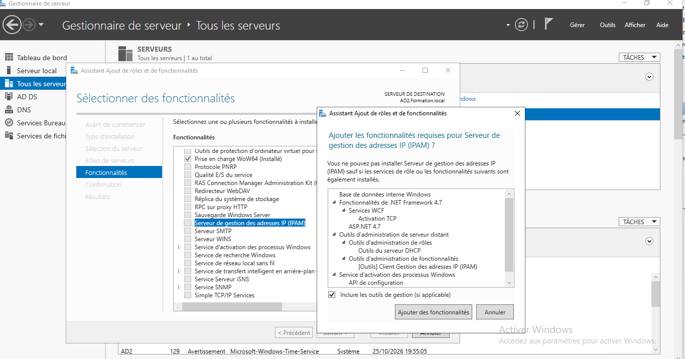
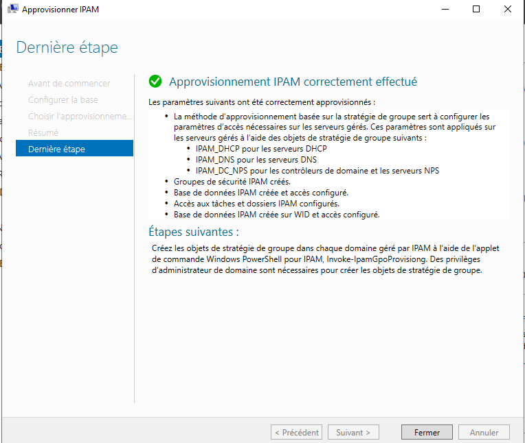
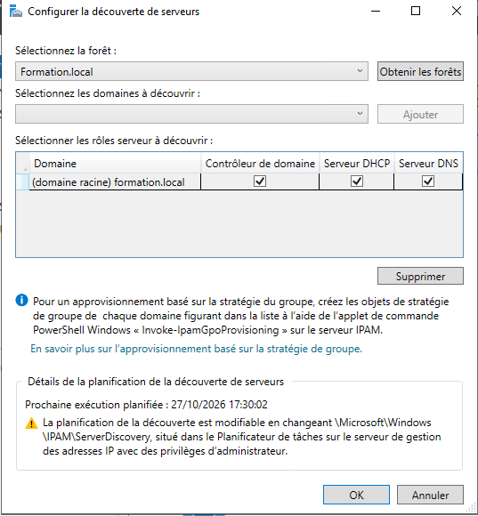
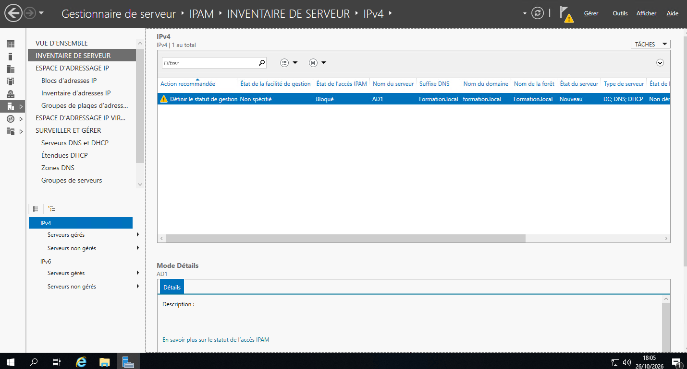
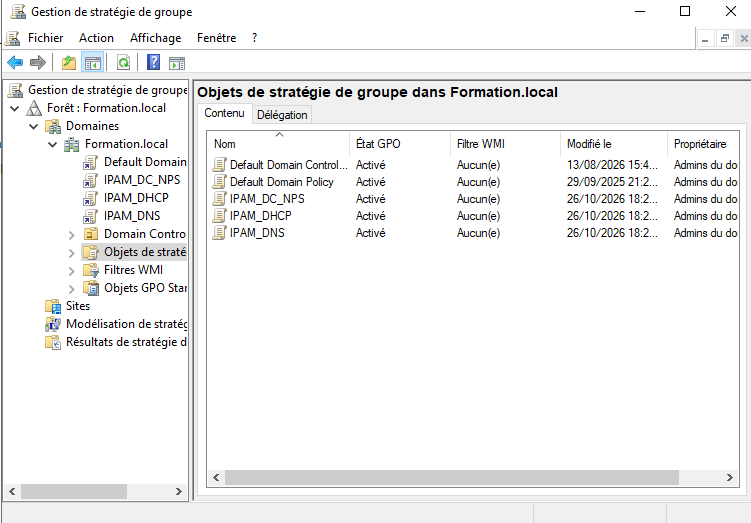
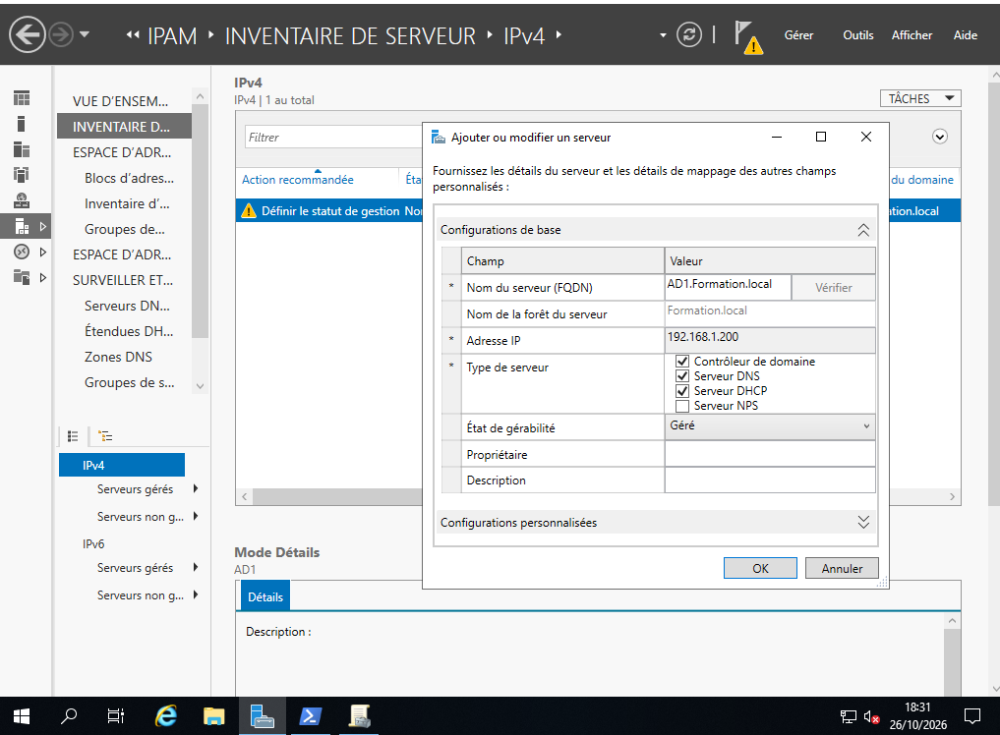

# **IPAM**

IPAM (IP Address Management) est une fonctionnalité intégrée dans les systèmes d’exploitation Microsoft depuis 
Windows Server 2012. Elle donne la possibilité de découvrir, surveiller, auditer et gérer une ou plusieurs plages 
d’adresses IP. De plus il est possible d’effectuer des tâches d’administration et de surveillance des serveurs DHCP et DNS.

Les composants suivants sont compris dans la fonctionnalité :  
- Découverte automatique de l’infrastructure des adresses IP : cela permet d’effectuer la découverte des contrôleurs de domaine, des serveurs DHCP et des serveurs DNS dans le domaine souhaité. 
- Affichage, création de rapports et gestion personnalisés de l’espace d’adressage IP : cela permet d’obtenir des informations sur le suivi et l’utilisation des adresses IP. Ainsi les espaces d’adressages IPv4 et IPv6 peuvent être 
organisés en blocs d’adresses IP, en plages d’adresses IP et en adresses IP individuelles. 
- Audit des modifications de configuration du serveur et suivi de l’utilisation des adresses IP : permet l’affichage des différents événements opérationnels du serveur IPAM et DHCP géré par la fonctionnalité. Un suivi des 
adresses IP, ID de client, nom d’hôte ou nom d’utilisateur est également effectué. De plus les événements de baux DHCP et les événements d’ouverture de session utilisateur sont collectés sur les serveurs NPS (Network Policy Server), 
sur les contrôleurs de domaine et sur les serveurs DHCP.  

Deux méthodes sont envisageables pour déployer des serveurs IPAM : 
- Distribuée : un serveur IPAM sur chaque site de l’entreprise.
- Centralisée : un serveur pour l’ensemble de l’entreprise. 

IPAM effectue des tentatives périodiques de localisation des contrôleurs de domaine, des serveurs DNS et DHCP. 
Cette opération concerne évidemment les serveurs qui se trouvent dans l’étendue (unité d’organisation, domaine ou site AD) des stratégies de groupe. Afin d’être gérés par IPAM et d’autoriser l’accès à ce dernier, les paramètres de 
sécurité et les ports du serveur doivent être configurés. 

La communication entre le serveur IPAM et les serveurs gérés se fait par le biais de WMI ou RPC. 

# **2 - Les spécifications d’IPAM**

L’étendue de la découverte pour les serveurs IPAM est limitée uniquement à une seule forêt Active Directory. Les 
serveurs pris en charge (NPS, DNS et DHCP) doivent exécuter Windows Server 2008 (ou versions ultérieures) et être 
joints à un domaine. Attention certains éléments réseau (WINS  Windows Internet Naming Service , proxys…) ne 
sont pas pris en charge par le serveur IPAM.  

Une base de données de type interne peut être utilisée, il est également possible d’utiliser SQL Server. 

Un serveur IPAM peut prendre en charge plusieurs centaines de serveurs DHCP et serveurs DNS.  

Néanmoins aucune stratégie consistant à nettoyer la base de données au bout d’un certain temps n’est présente. 
L’administrateur doit donc effectuer cette opération manuellement. 

Avec l’installation d’IPAM, les fonctionnalités suivantes sont également installées : 

- Outils d’administration de serveur distant : installation des outils DHCP, DNS et du client IPAM, ceci afin 
d’effectuer la gestion à distance des différents serveurs gérés.

- Base de données interne Windows : une base de données doit être utilisée, elle peut être de type interne (utilisable uniquement par certains rôles et fonctionnalités du système d’exploitation). Depuis Windows Server 2012 
R2, il est possible d’utiliser une base de données SQL Server (sur le serveur IPAM ou un autre serveur).

- Service d’activation des processus Windows : élimine la dépendance au protocole HTTP en généralisant le modèle de processus IIS.
  
- Gestion des stratégies de groupe : installe la console MMC permettant la gestion des stratégies de groupe.
  
- .NET Framework : installation de la fonctionnalité .NET Framework 4.5.

# **3. Installation d’IPAM**
IPAM ne doit pas être installer sur un contrôleur de de domaine.

Pour installer le service on lance la console "Gestionnaire de serveur", dans notre exemple cela sera sur AD2
Dans les fenêtres Sélectionner le type d’installation et Sélectionner le serveur de destination, on clique sur "Suivant" en laissant le choix par défaut. 
Dans la fenêtre de sélection des fonctionnalités, cochez la case Serveur de gestion des adresses IP puis on clique sur le bouton "Ajouter des fonctionnalités" dans la fenêtre qui apparaît.

Dans la console Gestionnaire de serveur, cliquez sur IPAM afin d’afficher la page de présentation.
Puis cliquez sur le lien "Configurer le serveur IPAM"

Ma configuration aura la méthode d'approvisionnement basé sur une stratégie de groupe et dans le champ Préfixe du nom d’objet de stratégie de groupe, j'ai saisi "IPAM".

Ensuite on va Configurer la découverte de serveurs
On clique sur "Obtenir les forêt"s afin d’ajouter le domaine Formation.local dans l’étendue.

On clique sur Ajouter.  
On Configure les rôles à découvrir en décochant ceux non souhaités. 

On clique sur OK. 
Dans la fenêtre VUE D’ENSEMBLE, cliquez sur Démarrer la découverte. 
Cliquez sur Autres dans le bandeau jaune afin d’avoir plus de détails. 

Ensuite dans "Inventaire de Serveur", on peut voir les serveurs et leurs états :

Il est maintenant nécessaire de donner à AD2 le droit de gérer les différents serveurs. Nous allons donc utiliser les 
objets de stratégie de groupe pour autoriser l’accès aux serveurs NPS (Network Policy Server), DHCP (Dynamic Host 
Configuration Protocol) et DNS (Domain Name System). Dans notre cas seul, DNS et DHCP sont présents sur le réseau 
local.

Sur le serveur ayant le rôle IPAM, lancez une console PowerShell en tant qu’administrateur. 
Saisissez la commande ci-dessous puis appuyez sur [Entrée] :

Invoke-IpamGpoProvisioning -Domain formation.local -GpoPrefixName IPAM -IpamServerFqdn ad2.formation.local

De nouvelles stratégies sont présentes dans la console Gestion de stratégie de groupe. 

Dans la console de configuration d’IPAM, effectuez un clic droit sur la ligne AD1 puis sélectionnez Modifier 
serveur. 
Dans la liste déroulante État de gérabilité, sélectionnez Géré. 
Cliquez sur OK. 

Sur le serveur AD1, ouvrez une invite de commandes DOS et saisissez la commande gpupdate /force 
puis redémarrez le serveur. Ceci permet l’application des stratégies de groupe précédemment créées avec 
la commande PowerShel
